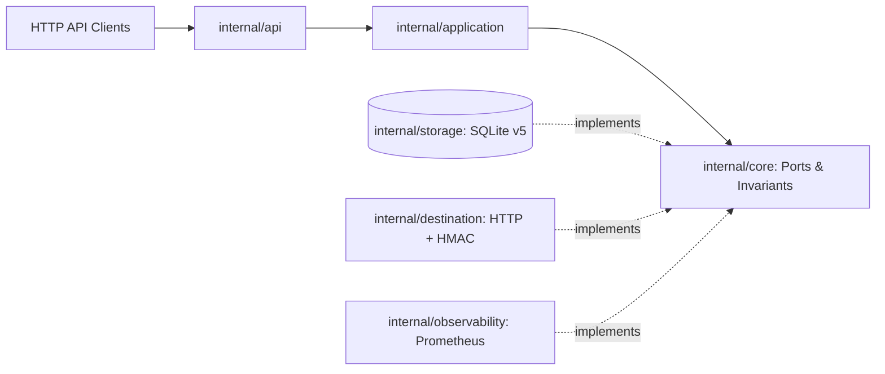

# HookRelay

[](https://github.com/NickDavid1811/hookrelay/actions/workflows/ci.yml)
[](go.mod)
[](docs/README.md)

**HookRelay** is a resilient, self-hosted, persistent webhook dispatching engine built in pure Go and SQLite. It provides atomic ingestion, durable lease-based background workers, exponential backoff with full jitter, cryptographic HMAC signatures, and dynamic endpoint configuration—all organized under a strict **Hexagonal Architecture** (Ports and Adapters).

Documentation: [English](docs/README.md) · [Español](docs/es/README.md)

---

## Table of Contents

- [Overview & Architecture](#overview--architecture)
- [Key Features & Guarantees](#key-features--guarantees)
- [Quick Start](#quick-start)
  - [Prerequisites](#prerequisites)
  - [Build and Run](#build--run-binaries)
  - [Publishing Your First Event](#publishing-your-first-event)
  - [Querying Status and History](#querying-status-and-history)
- [Interactive Visual Flow Lab](#interactive-visual-flow-lab)
- [CLI Reference](#cli-reference)
  - [Dispatcher Flags](#dispatcher-flags)
  - [Receiver Flags](#receiver-flags)
- [HTTP API Reference](#http-api-reference)
  - [Publish Event](#1-publish-event)
  - [Query Delivery Status](#2-query-delivery-status)
  - [Query Delivery Attempts](#3-query-delivery-attempts)
  - [Replay Dead Deliveries](#4-replay-dead-deliveries)
  - [Query Replay Audit Trail](#5-query-replay-audit-trail)
  - [Register Dynamic Endpoint](#6-register-dynamic-endpoint)
  - [Health and Readiness](#7-health-and-readiness)
  - [Prometheus Metrics](#8-prometheus-metrics)
- [Reliability & Failure Recovery](#reliability--failure-recovery)
  - [Crash Recovery & Leases](#crash-recovery--leases)
  - [Backup & Restore](#backup--restore)
  - [Storage Failures](#storage-failures)
- [Security & SSRF Mitigation](#security--ssrf-mitigation)
- [Testing & Quality Assurance](#testing--quality-assurance)
- [License & Documentation Links](#license--documentation-links)

---

## Overview & Architecture

HookRelay is built as a modular monolith following **Hexagonal Architecture** principles, enforcing absolute decoupling between business invariants, persistence, network transport, and presentation:



### Package Responsibilities

| Package | Responsibility | Production Dependencies |
| :--- | :--- | :--- |
| **`internal/core`** | Domain types, business errors, capacity limits, retry policies (`MaxAttempts`), lease rules, HMAC contracts, and abstract outbound ports (`PublicationStore`, `ReplayStore`, `QueryStore`, `QueueStore`, `EndpointStore`, `Sender`, `Observer`). | None (standard library only) |
| **`internal/application`** | Coordinates use cases: publishing, dynamic endpoint creation through a side-effect-free destination policy, delivery claim and execution, manual replays, and background maintenance. | `core` |
| **`internal/api`** | HTTP inbound adapters, route multiplexing, bearer token authentication, request size bounds, and JSON mapping. | `core` |
| **`internal/storage`** | Pure Go SQLite engine (`modernc.org/sqlite`), schema v5 migrations, transactional queries, snapshot aggregation, and dynamic endpoint persistence. | `core` |
| **`internal/destination`** | Outbound HTTP transport, anti-SSRF protections, strict DNS pinning, and cryptographic HMAC-SHA256 request signing. | `core` |
| **`internal/observability`** | Prometheus scrape authentication, runtime counters, histograms, and transactional gauges. | `core` |
| **`internal/relay`** | Composition root, configuration loading, static destination map, committed dynamic destination lookup, explicit startup validation, and worker pool lifecycle. | All internal packages |
| **`cmd/dispatcher`** | CLI parsing, signal handling (`SIGINT`, `SIGTERM`), and graceful shutdown orchestration. | `relay` |
| **`cmd/receiver`** | Standalone test destination server verifying HMAC signatures and simulating failure modes. | `core`, `destination` |

---

## Key Features & Guarantees

- **Atomic Acceptance**: Events and deliveries are committed together before HTTP `202 Accepted`. Workers may send duplicates after an interrupted attempt. Retry budgets are finite: a delivery can become `DEAD`; eventual receipt, business processing, ordering and exactly-once effects are not guaranteed.
- **Strict Idempotency**: Publication requests with identical `Idempotency-Key` and matching SHA-256 of the complete original request bytes return the original accepted receipt. Mismatched payloads return `409 Conflict`.
- **Concurrent Worker Pool**: Configurable multi-goroutine worker pool (`--workers 1..50`) with graceful shutdown (`sync.WaitGroup`) and atomic active task counting.
- **Dynamic Endpoints API**: Runtime creation and registration of endpoints (`POST /api/v1/endpoints`) with transactional persistence in SQLite (Schema v5). Dispatch resolves committed dynamic destinations directly from storage.
- **Configurable Retries**: Dynamic finite retry limit (`--max-attempts 1..50`, default `5`), integrated into domain limits.
- **Lease-Based Worker Claims**: Workers acquire 30-second atomic leases. Interrupted or crashed jobs are automatically reclaimed upon lease expiration.
- **Anti-SSRF & DNS Pinning**: Blocks RFC 1918, loopbacks, link-local, AWS/GCP metadata endpoints (169.254.0.0/16), IPv6 special addresses, and DNS rebinding attacks with dial-time IP verification.
- **Prometheus Observability**: Native metrics at `/metrics` with dedicated operator bearer token authentication.
- **Backup & Restore**: Consistent snapshots via the SQLite Backup API (`scripts/backup.py`), with integrity, references and versioned schema checks. Use the offline operational procedure below.

---

## Quick Start

### Option A: Local demonstration with Docker Compose

Requires Docker Engine and Compose. This demo includes a receiver sharing the dispatcher network namespace, so the test destination stays on loopback.

```bash
git clone https://github.com/NickDavid1811/hookrelay.git
cd hookrelay
docker compose up --build -d --wait
```

The demo listens on `http://127.0.0.1:8080` only on the host loopback interface and persists SQLite in a Docker volume. It uses public example credentials (`local-token-change-me` / `local-secret-change-me`); use them only locally. Stop with `docker compose down` (volume retained). Real deployments need private credentials, operator configuration and a TLS reverse proxy; this Compose file is not a production deployment recipe.

---

### Option B: Build and Run from Source

#### Prerequisites
- **Go**: 1.27.2 or later (pure Go SQLite, no CGO required).
- **Python**: 3.10+ (for integration tests and backup tooling).
- **Node.js**: 24+ & npm (optional, only for the visual Flow Lab).

#### Build & Run Binaries

1. **Build binaries**:
   ```bash
   make build
   ```

2. **Start the test receiver** (Terminal 1):
   ```bash
   export HOOKRELAY_SECRET='local-secret-change-me'
   ./bin/receiver --listen 127.0.0.1:9090
   ```

3. **Start the HookRelay dispatcher** (Terminal 2):
   ```bash
   export HOOKRELAY_TOKEN='local-token-change-me'
   export HOOKRELAY_SECRET='local-secret-change-me'
   ./bin/dispatcher --allow-loopback-test --workers 4 --max-attempts 5
   ```

### Publishing Your First Event

In another terminal, set the same token explicitly and publish an event:

```bash
export HOOKRELAY_TOKEN='local-token-change-me'
curl -i http://127.0.0.1:8080/api/v1/publish \
  -H "Authorization: Bearer $HOOKRELAY_TOKEN" \
  -H 'Idempotency-Key: order-paid-1001' \
  -H 'Content-Type: application/json' \
  -d '{
    "endpoint_id": "test",
    "event_type": "order.completed",
    "payload": {"order_id": "ord_9921", "total": 49.99}
  }'
```

Response (`202 Accepted`):
```json
{
  "event_id": "d82abf71b96a4bc2a981a6e76c123456",
  "delivery_id": "e41fc76a5912448ca83d5bc781abcdef",
  "status": "PENDING"
}
```

### Querying Status and History

Check the final delivery state:
```bash
curl -s -H "Authorization: Bearer $HOOKRELAY_TOKEN" \
  http://127.0.0.1:8080/api/v1/deliveries/YOUR_DELIVERY_ID | jq .
```

Inspect the attempt history:
```bash
curl -s -H "Authorization: Bearer $HOOKRELAY_TOKEN" \
  http://127.0.0.1:8080/api/v1/deliveries/YOUR_DELIVERY_ID/attempts | jq .
```

---

## Interactive Visual Flow Lab

HookRelay includes an interactive visual simulator and management console built with React, Vite, and TanStack Query:

```bash
make web-install
make playground
```

Open your browser at **`http://127.0.0.1:8090`** to test simulated failure scenarios (e.g. `204 Success`, `Slow Response`, `429 Rate Limited`, `503 Service Unavailable`, `Dropped Connection`, `Exhausted Retries`), trigger replays, and inspect delivery animations.

For comprehensive architectural and design details, see [docs/PLAYGROUND.md](docs/PLAYGROUND.md) and [docs/history/PLAYGROUND_UX.md](docs/history/PLAYGROUND_UX.md).

---

## CLI Reference

### Dispatcher Flags

Run `./bin/dispatcher --help` to list all runtime configuration options:

| Flag | Default | Description |
| :--- | :--- | :--- |
| `--db` | `hookrelay.db` | Path to SQLite database file. |
| `--listen` | `127.0.0.1:8080` | Bind address for inbound HTTP API. |
| `--workers` | `1` | Number of concurrent dispatch workers (`1` to `50`). |
| `--max-endpoints` | `1000` | Maximum retained endpoint records globally. |
| `--max-client-endpoints` | `100` | Maximum retained endpoint records per client. |
| `--max-attempts` | `5` | Maximum delivery attempts per cycle before marking as `DEAD` (`1` to `50`). |
| `--insecure-allow-remote-listen` | `false` | Allows listening on non-loopback addresses (`0.0.0.0` or external IPs) for containerized environments (Docker/K8s). Emits a security audit warning on startup. |
| `--allow-loopback-test` | `false` | Permissive testing mode allowing loopback HTTP endpoints (`127.0.0.1`). |
| `--endpoint` | `http://127.0.0.1:9090/webhook` | Default fallback endpoint URL in single-endpoint mode. |
| `--config` | `""` | Path to client/endpoint JSON configuration file for multi-tenancy. |
| `--retry-after-max` | `5m` | Ceiling for the persisted delay requested by `Retry-After` HTTP headers. |
| `--max-queue` | `10000` | Global maximum unfinished deliveries before rejecting admissions (`503`). |
| `--max-client-queue` | `1000` | Maximum unfinished deliveries per client before admission rejection (`429`). |
| `--max-events` | `20000` | Retention ceiling for all events (active + terminal). |
| `--max-payload-bytes` | `268435456` | Maximum total retained payload size (256 MiB). |
| `--max-cycles` | `10` | Maximum total cycles per delivery, including the initial cycle. |
| `--success-retention` | `168h` | Time to retain `SUCCESS` deliveries before automatic purge (7 days). |
| `--dead-retention` | `720h` | Time to retain `DEAD` deliveries before automatic purge (30 days). |
| `--cleanup-interval` | `1m` | Interval between background retention cleanup sweeps. |
| `--cleanup-batch` | `100` | Maximum events deleted per cleanup transaction. |

### Receiver Flags

Run `./bin/receiver --help`:

| Flag | Default | Description |
| :--- | :--- | :--- |
| `--listen` | `127.0.0.1:9090` | Listening address for webhook receptions. |
| `--mode` | `normal` | Simulation mode: `normal`, `slow`, `503`, `429`, or `drop`. |
| `--delay` | `7s` | Latency delay applied when running in `slow` mode. |
| `--fail-first` | `1` | Number of initial requests affected by failure mode before responding `204`. |
| `--ledger` | `""` | Path to JSONL log recording receipt identifiers and timing; it does not retain payloads or signatures. |

---

## HTTP API Reference

All requests must supply the client authorization token via the `Authorization: Bearer <TOKEN>` header, unless otherwise specified.

### 1. Publish Event
`POST /api/v1/publish`

Publishes an event and enqueues a delivery atomically.

**Headers:**
- `Authorization: Bearer <TOKEN>` (Required)
- `Idempotency-Key: <STRING>` (Required, 1–128 bytes)
- `Content-Type: application/json`

**Body:**
```json
{
  "endpoint_id": "test",
  "event_type": "invoice.paid",
  "payload": {
    "invoice_id": "inv_12345",
    "amount": 199.00
  }
}
```

**Response (`202 Accepted`):**
```json
{
  "event_id": "3a0df47a468d4f4095db6a18d361c471",
  "delivery_id": "67b9356ef38243549646b1a37c95690b",
  "status": "PENDING"
}
```

---

### 2. Query Delivery Status
`GET /api/v1/deliveries/:id`

Retrieves the current state and latest cycle metrics for a delivery.

**Response (`200 OK`):**
```json
{
  "event_id": "3a0df47a468d4f4095db6a18d361c471",
  "delivery_id": "67b9356ef38243549646b1a37c95690b",
  "status": "SUCCESS",
  "attempts": 2,
  "cycle": 1,
  "cycle_attempts": 2,
  "http_status": 204
}
```

---

### 3. Query Delivery Attempts
`GET /api/v1/deliveries/:id/attempts?after=0`

Returns a paginated list of all execution attempts (up to 100 per page).

**Response (`200 OK`):**
```json
[
  {
    "number": 1,
    "cycle": 1,
    "http_status": 503,
    "error": "service unavailable",
    "completed_unix_ms": 1792081015000
  },
  {
    "number": 2,
    "cycle": 1,
    "http_status": 204,
    "error": "",
    "completed_unix_ms": 1792081017500
  }
]
```

---

### 4. Replay Dead Deliveries
`POST /api/v1/deliveries/:id/replay`

Re-enqueues a `DEAD` delivery into a new attempt cycle.

**Body:**
```json
{
  "expected_cycle": 1,
  "reason": "Destination service restored after outage"
}
```

**Response (`202 Accepted`):**
```json
{
  "delivery_id": "67b9356ef38243549646b1a37c95690b",
  "cycle": 2,
  "status": "PENDING"
}
```

---

### 5. Query Replay Audit Trail
`GET /api/v1/deliveries/:id/replays?after=0`

Returns the audit record of manual replays requested for this delivery.

---

### 6. Register Dynamic Endpoint
`POST /api/v1/endpoints`

Registers an immutable delivery destination at runtime. Validation has no runtime side effects; uniqueness and quotas are checked in the same SQLite transaction as insertion. Dynamic destinations are resolved from committed rows when dispatching.

**Body:**
```json
{
  "id": "payments-webhook",
  "url": "https://api.example.com/webhooks/payments",
  "secret": "super-secret-hmac-key-at-least-16-bytes"
}
```

*If `secret` is omitted, HookRelay generates an `hrsec_` prefix followed by 256 random bits encoded as hexadecimal. Loopback requests (`allow_loopback` or `allow_loopback_test`) require the operator flag `--allow-loopback-test`; clients cannot enable this permission themselves.*

**Response (`201 Created`):**
```json
{
  "id": "payments-webhook",
  "url": "https://api.example.com/webhooks/payments",
  "secret": "hrsec_example_returned_once"
}
```

---

Endpoint admission defaults to **1000 retained endpoints globally** and **100 per client**, including static and inactive records. Configure `--max-endpoints` and `--max-client-endpoints`; client/global exhaustion returns 429/503. A duplicate ID returns 409 and cannot change a committed destination.

For API-managed endpoints, `DELETE /api/v1/endpoints/{id}` returns 409 while any delivery is PENDING, RETRYING, or PROCESSING. After a successful deletion, terminal history remains available. Retention cleanup reclaims inactive dynamic endpoints once no retained deliveries reference them, freeing endpoint capacity. Existing unfinished work on endpoints deleted by earlier versions requires explicit reconciliation after backup; this change does not reactivate previously deleted destinations.

### 7. Health and Readiness
`GET /readyz`

This probe calls SQLite Ping and returns HTTP `200 OK` when the connection responds. It does not prove worker progress, database writability, disk capacity or receiver availability. `GET /healthz` checks process liveness.

---

### 8. Prometheus Metrics
`GET /metrics`

Requires the operator token supplied via `Authorization: Bearer $HOOKRELAY_METRICS_TOKEN`. Returns standard Prometheus text exposition format:

```text
# HELP hookrelay_deliveries Total deliveries by status
# TYPE hookrelay_deliveries gauge
hookrelay_deliveries{state="SUCCESS"} 142
hookrelay_deliveries{state="PENDING"} 3
hookrelay_deliveries{state="DEAD"} 0

# HELP hookrelay_worker_running Worker pool active status
# TYPE hookrelay_worker_running gauge
hookrelay_worker_running 1
```

---

## Reliability & Failure Recovery

### Crash Recovery & Leases

HookRelay recovers abandoned leases after a process crash. The automated suite verifies `SIGKILL` recovery; it does not simulate power loss, kernel failure or damaged storage:
1. When a worker claims a delivery, it acquires a **30-second atomic lease** in SQLite.
2. If the dispatcher process is terminated abruptly (e.g. `SIGKILL`), the lease remains in `PROCESSING`.
3. Upon restart or after the lease expires, the scheduler re-evaluates the delivery and safely re-enqueues it for dispatch.
4. Because the receiver might have executed the webhook before the crash, destination receivers should implement idempotency using the stable `X-Webhook-Id` or `X-Webhook-Delivery-Id` headers.

### Backup & Restore

Use this offline procedure for backup and restore. The SQLite Backup API includes committed WAL data and publishes a snapshot atomically without overwriting an existing file. It can operate on a live database, but busy writers may delay it; there is no non-blocking completion guarantee.

1. Stop the dispatcher and confirm the process has exited. Preserve its configuration, startup flags and environment secrets separately, with restricted permissions. SQLite contains dynamic endpoint secrets in plaintext; snapshots need the same protection.
2. Create the backup directory and choose a new filename. Do not copy only the `.db` file from an active WAL database or discard its sidecars.
3. Run the backup command, then restore to a **new** path with an existing parent directory. The utility refuses existing destinations and SQLite sidecars; it does not stop running dispatchers or replace an active database.

```bash
mkdir -p ./backups ./restored
python3 scripts/backup.py backup ./hookrelay.db ./backups/snapshot.db
python3 scripts/backup.py restore ./backups/snapshot.db ./restored/hookrelay.db
```

Restart using the same client identities, configuration and secrets, changing only `--db` to the restored path. For the local source demo:

```bash
export HOOKRELAY_TOKEN='local-token-change-me'
export HOOKRELAY_SECRET='local-secret-change-me'
./bin/dispatcher --allow-loopback-test --db ./restored/hookrelay.db
```

Verify `/readyz`, delivery histories and resumed work before resuming publishers. Recovery can resend an in-flight webhook; receivers must deduplicate. Keep the original database until restoration is verified, and never run two dispatchers against the original and restored copies as an active pair. Historical unfinished work whose destination was removed requires explicit reconciliation.

Validation checks integrity, foreign keys and the required table/index/trigger DDL for the declared schema version (1–5), using `scripts/backup_schema.json`. Extra objects are not certified; this is not an application data or storage hardware audit. Output files have mode `0600`.

---

### Storage Failures

SQLite write failures return `503`; after an I/O/synchronization failure, treat the commit outcome as uncertain and retry the original bytes with the same idempotency key. Transactions preserve their event, delivery, idempotency and audit boundaries. A dispatch/finalization failure stops the worker run and propagates to the executable; accepted work remains persisted for lease recovery. A receiver may already have accepted a request whose finalization failed, so recovery can resend it with the same delivery ID.

`make test` covers SQLite FULL at transaction boundaries, a read-only writer and a competing writer. `make storage-full-test` additionally fills a disposable 4 MiB Docker tmpfs to verify actual OS `ENOSPC` during publication and finalization, then frees space and checks recovery. GitHub Actions runs both targets, plus the I/O/interruption target. The filesystem target requires Docker and does not write to the host database.

For evidence boundaries and the recovery procedure, see [Storage Failure Validation](docs/STORAGE_FAILURES.md). Do not delete live SQLite WAL files to free space; restore write capacity before restarting. `make storage-io-test` also injects WAL write/sync EIO errors and verifies recovery after an interrupted transaction and incomplete WAL tail. Storage startup runs a structural `quick_check` before migrations; backup validation uses the full integrity check. These controls do not certify physical power-loss durability or detect every form of corruption.

---

## Security & SSRF Mitigation

Outbound webhooks pose significant **Server-Side Request Forgery (SSRF)** risks. HookRelay enforces strict defense-in-depth:

1. **Deny-by-Default Networks**: Outbound connections to private IP spaces (RFC 1918), loopbacks (`127.0.0.0/8`), link-local metadata addresses (`169.254.0.0/16`), Carrier-Grade NAT (`100.64.0.0/10`), documentation blocks, IPv6 transition ranges (6to4, NAT64), and multicast are hard-blocked.
2. **DNS Pinning**: All resolved IP addresses for a host are evaluated. If any IP resolves to a restricted block, the entire connection is aborted. The dialer directly connects to the validated IP, preventing DNS rebinding TOCTOU attacks.
3. **Payload Signature (HMAC-SHA256)**: Webhook requests include the following standard signature headers:
   - `X-Webhook-Id`: Unique event ID.
   - `X-Webhook-Delivery-Id`: Unique delivery ID.
   - `X-Webhook-Timestamp`: Current UTC epoch seconds.
   - `X-Webhook-Signature`: Hexadecimal HMAC-SHA256 of `timestamp + "." + payload`.
4. **Tolerance Window**: Receivers can verify that the timestamp falls within a $\pm 300\text{s}$ tolerance window to reject stale requests. Requests can still be replayed inside that window; the receiver must deduplicate stable event/delivery IDs to prevent repeated effects.

---

## Testing & Quality Assurance

HookRelay maintains rigorous end-to-end integration and concurrency testing:

```bash
# Run unit tests and race detection across all packages
make test

# Run code formatting and vet checks
gofmt -l cmd internal
go vet ./...

# Run the complete CI verification pipeline
make ci
```

`make lint` always runs formatting checks and `go vet`; no optional linter is silently substituted. `make vulncheck` runs the version-pinned Go vulnerability scanner and fails on scan/download errors or reachable known vulnerabilities. These checks also run in CI. The scanner requires network access to the Go module proxy and vulnerability database.

### Specialized Test Suites

- **`make smoke`**: End-to-end verification of publish, deliver, HMAC verification, and status resolution using live processes.
- **`make failures`**: Comprehensive fault injection test covering 503 retries, 429 backoff, slow responses, dropped connections, retry exhaustion, and `SIGKILL` crash recovery.
- **`make backup-test`**: Validates backup atomicity, corruption rejection, and full database restores.
- **`make tenants`**: Tests multi-tenant isolation, distinct secrets, and configuration changes.
- **`make storage-io-test`**: Injects WAL write/sync errors and verifies committed-prefix recovery after interrupted writes inside an isolated Docker container.
- **`make storage-full-test`**: Verifies real filesystem ENOSPC and recovery inside a bounded Docker tmpfs; separate from `make ci`, required by GitHub Actions.
- **`make capacity`**: Stress-tests queue boundaries, client quotas, and automatic retention sweeps.

---

## License & Documentation Links

For licensing terms, see [LICENSE](LICENSE).

Start with the [documentation index](docs/README.md) or the [complete Spanish edition](docs/es/README.md). For architecture, historical measurements and engineering records:
- [Maintainer Guide & Operational Invariants](docs/MAINTAINING.md)
- [Architecture & Design Details](docs/ARCHITECTURE.md)
- [Engineering Session & History](docs/history/SESSION.md)
- [Master Project Context](docs/CONTEXT_MASTER.md)
- [Flow Lab & Visual Simulator](docs/PLAYGROUND.md)
- [UX Design Specifications](docs/history/PLAYGROUND_UX.md)
- [Performance & Benchmark Reports](docs/benchmarks/HEXAGONAL.md)

Backend reliability: exponential backoff saturates at 5 minutes before jitter; the configured `Retry-After` ceiling remains separate. SQLite connection settings apply to every physical connection. Shutdown waits for dispatch and maintenance, and operational failures exit with status 1.

### API and retention limits

`GET /api/v1/endpoints` returns at most 1,000 active records sorted by ID. Pass the final `id` as the URL-encoded `after` query parameter and continue until an empty array. Pages reflect current committed data, not a snapshot across requests. Endpoints defined in configuration are operator-managed: API deletion returns `409`; remove them from configuration and restart. API-created endpoints can be deleted once unfinished work has completed.

The 64 KiB publication limit covers the complete HTTP request body. `payload` may be any JSON value, including `null`. Idempotency compares the complete original request bytes, including whitespace, and is retained only while the event is retained. After retention removes its key, the same key can create a new event. Repeated publication returns the original acceptance receipt; use the delivery GET for current status. Attempt history counts committed finalizations and may omit network sends interrupted by process death. Payload quotas exclude SQLite indexes, WAL, histories and backups; monitor filesystem capacity separately.
