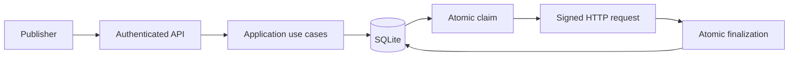

# Architecture and data model

[Español](es/ARCHITECTURE.md) · Documentation review: 2026-10-16.

HookRelay is a modular Go monolith with ports and adapters. One dispatcher deployment owns a local SQLite database; a bounded pool of workers sends requests. Package boundaries are code responsibilities, not independently deployed services.

## Packages and dependencies

| Package | Responsibility | Internal production dependencies |
| --- | --- | --- |
| `internal/core` | Data, errors, limits, retry rules and persistence/sender/observer ports | Standard library only |
| `internal/application` | Publication, endpoint use cases, queries, replay, dispatch and maintenance | `core` |
| `internal/api` | HTTP routing, authentication, bounded reads and error translation | `core` |
| `internal/storage` | SQLite v5, migrations, configuration, queries and transactions | `core` |
| `internal/destination` | Destination policy, DNS/dial restrictions, HTTP and HMAC | `core` |
| `internal/observability` | Protected Prometheus metrics and storage snapshot presentation | `core` |
| `internal/relay` | Composition, startup configuration, endpoint resolution and compatibility facade | The backend packages above |
| `internal/playground` | Local client/receiver adapter for the lab; no direct SQL | `core`, `destination` |
| `cmd/dispatcher` | Flags, listener, signals and process lifetime | `relay` |
| `cmd/receiver` | Test receiver and signature verification | `core`, `destination` |
| `cmd/playground` | Isolated lab composition and web server | `relay`, `playground` |

The API consumes `api.UseCases`. The application implements those use cases without importing the API adapter. Output ports include `PublicationStore`, `ReplayStore`, `QueryStore`, `QueueStore`, `EndpointStore`, `Sender` and `Observer`. `application.EndpointPolicy` validates destinations without mutation. SQL stays in storage; the core/application production packages do not depend on HTTP infrastructure, SQL or Prometheus.

## Publication and dispatch



1. Publication validates the envelope and client. One transaction checks idempotency, endpoint ownership and capacity, then commits the event, delivery and receipt.
2. Each worker atomically claims eligible work with a random fencing token and a 30-second lease. Eligible records are selected by delivery row ID; there is no tenant-fair scheduling guarantee.
3. The worker loads the stored payload and sends it outside any database transaction, with a 5-second request timeout.
4. Finalization checks ownership of the claim and current lease validity, then commits state and attempt history together. Metrics for committed results advance only after success. An HTTP observation can exist without a committed finalization.
5. Replay atomically opens a new cycle and records its audit entry. Retention removes complete eligible event graphs in a bounded transaction.

```text
PENDING / RETRYING -> PROCESSING -> SUCCESS / RETRYING / DEAD
Expired PROCESSING claim -> eligible for another claim
DEAD -> PENDING through an authorized replay with matching expected_cycle
```

Workers take available work consecutively and wait 100 ms when no eligible work exists. The pool is configurable from 1 to 50 workers; it is not a requests-per-second limiter. Maintenance runs separately. Shutdown cancels and joins workers and maintenance before closing storage; operational failures propagate to a nonzero process exit.

## SQLite schema v5

| Table | Purpose |
| --- | --- |
| `clients` | Client ID, token hash and active flag |
| `endpoints` | Globally unique ID, owner, URL, static secret environment reference, dynamic secret, loopback permission and active flag |
| `events` | Event ID, event type (`kind`), payload bytes (`body`), creation time and owner |
| `deliveries` | Event/endpoint references, state, finalized attempt counts, cycle, next eligibility, lease/token, latest outcome and terminal time |
| `keys` | Client-scoped idempotency key, complete-request hash and original event/delivery IDs |
| `attempts` | Committed attempt number, cycle, status/error and completion time |
| `replays` | New cycle, authenticated client actor, reason and request time |

Foreign keys, ownership triggers and transaction predicates enforce the graph. Relevant indexes cover eligibility, event ownership, event references and retention. Canonical DDL is in `internal/storage/migrations.go` and `scripts/backup_schema.json`; this table is explanatory, not replacement DDL.

Migrations 1–5 are transactional. V2 added replay cycles, v3 clients/endpoint ownership, v4 terminal timestamps and retention indexes, and v5 the `secret` column on `endpoints`. There is no `dynamic_endpoints` table. Future versions are rejected. Startup runs `quick_check(1)` before journal changes and migration; it is not a full corruption audit.

The writer has one physical connection with WAL/FULL. A read-only pool allows concurrent reads, up to 32 connections. DSN pragmas apply to replacement physical connections too. `:memory:` shares the writer pool rather than opening an unrelated reader database.

## Endpoint resolution and telemetry

Static endpoints resolve environment secrets during startup configuration and use a prepared runtime map. Dynamic endpoints resolve committed URL/secret rows after claim; there is no dynamic cache or cross-type secret fallback. This adds lookup/client construction cost per dynamic send. Configuration and API ownership rules are in [configuration](CONFIGURATION.md).

Storage snapshots return neutral aggregates; the observability adapter adds metric names. Snapshot queries and in-memory counters do not share a transaction. See [operations](OPERATIONS.md) for interpretation.

The lab composes an isolated instance and consumes its HTTP API. React uses feature folders, TanStack Query for remote state and a pure reducer for visual playback. Animation never acts as a second delivery engine.

## Architectural verification

`TestArchitectureDependencies` checks production imports. Application tests exercise ports through doubles; `TestHexagonalVerticalWithoutSockets` connects real handlers, application, SQLite and an in-memory HTTP transport. Socket/process suites complement these tests. A passing race test is evidence for exercised executions, not proof of all possible schedules. See [maintenance](MAINTAINING.md) and [dated history](history/SESSION.md).
