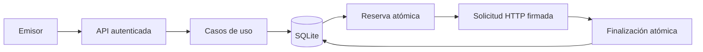

# Arquitectura y modelo de datos

[English](../ARCHITECTURE.md) · Revisión documental: 2026-10-16.

HookRelay es un monolito modular en Go con puertos y adaptadores. Un despliegue del dispatcher administra SQLite local; un pool acotado de workers envía solicitudes. Los paquetes representan responsabilidades del código, no servicios desplegados por separado.

## Paquetes y dependencias

| Paquete | Responsabilidad | Dependencias internas de producción |
| --- | --- | --- |
| `internal/core` | Datos, errores, límites, reintentos y puertos de persistencia/envío/observación | Solo biblioteca estándar |
| `internal/application` | Publicación, endpoints, consultas, replay, envío y mantenimiento | `core` |
| `internal/api` | Rutas HTTP, autenticación, lectura acotada y traducción de errores | `core` |
| `internal/storage` | SQLite v5, migraciones, configuración, consultas y transacciones | `core` |
| `internal/destination` | Política de destinos, restricciones DNS/conexión, HTTP y HMAC | `core` |
| `internal/observability` | Métricas Prometheus protegidas y presentación del snapshot | `core` |
| `internal/relay` | Composición, configuración inicial, resolución de destinos y fachada compatible | Paquetes backend anteriores |
| `internal/playground` | Adaptador cliente/receptor local del laboratorio; sin SQL directo | `core`, `destination` |
| `cmd/dispatcher` | Flags, listener, señales y ciclo de vida del proceso | `relay` |
| `cmd/receiver` | Receptor de prueba y verificación de firmas | `core`, `destination` |
| `cmd/playground` | Composición del laboratorio aislado y servidor web | `relay`, `playground` |

La API consume `api.UseCases`. La aplicación implementa esos casos sin importar el adaptador API. Los puertos de salida incluyen `PublicationStore`, `ReplayStore`, `QueryStore`, `QueueStore`, `EndpointStore`, `Sender` y `Observer`. `application.EndpointPolicy` valida destinos sin modificar estado. SQL permanece en almacenamiento; el código productivo de core/application no depende de infraestructura HTTP, SQL ni Prometheus.

## Publicación y envío



1. La publicación valida el sobre y el cliente. Una transacción comprueba idempotencia, propietario del endpoint y capacidad; confirma evento, entrega y recibo.
2. Cada worker reserva trabajo elegible atómicamente con token aleatorio y plazo de 30 segundos. Los registros se seleccionan por el ID interno de fila de entrega; no se garantiza reparto equitativo entre clientes.
3. El worker carga el payload persistido y lo envía fuera de transacciones, con timeout de 5 segundos.
4. La finalización comprueba el token y la vigencia actual de la reserva; confirma estado e historial juntos. Las métricas de resultados confirmados avanzan después del éxito. Puede existir una observación HTTP sin finalización persistida.
5. Replay abre un ciclo y registra su auditoría atómicamente. Retención elimina grafos completos elegibles mediante una transacción acotada.

```text
PENDING / RETRYING -> PROCESSING -> SUCCESS / RETRYING / DEAD
Reserva PROCESSING vencida -> elegible para otra reserva
DEAD -> PENDING mediante replay autorizado con expected_cycle coincidente
```

Los workers procesan consecutivamente el trabajo disponible y esperan 100 ms si no hay trabajo elegible. El pool admite de 1 a 50 workers; no limita solicitudes por segundo. Mantenimiento se ejecuta por separado. El apagado cancela y espera workers y mantenimiento antes de cerrar almacenamiento; los fallos operativos producen salida distinta de cero.

## Esquema SQLite v5

| Tabla | Propósito |
| --- | --- |
| `clients` | ID del cliente, hash del token y actividad |
| `endpoints` | ID global único, propietario, URL, referencia de entorno del secreto estático, secreto dinámico, permiso loopback y actividad |
| `events` | ID, tipo (`kind`), bytes del payload (`body`), creación y propietario |
| `deliveries` | Referencias a evento/endpoint, estado, intentos finalizados, ciclo, próxima elegibilidad, reserva/token, último resultado y fecha terminal |
| `keys` | Clave idempotente por cliente, hash de la solicitud completa e IDs originales |
| `attempts` | Número de intento confirmado, ciclo, estado/error y finalización |
| `replays` | Nuevo ciclo, cliente autenticado como actor, motivo y fecha |

Claves foráneas, triggers de propietario y condiciones transaccionales protegen el grafo. Los índices cubren elegibilidad, propietario del evento, referencias y retención. El DDL canónico está en `internal/storage/migrations.go` y `scripts/backup_schema.json`; esta tabla lo explica, no lo sustituye.

Las migraciones 1–5 son transaccionales. V2 añadió ciclos de replay; v3, clientes y propiedad; v4, fechas terminales e índices de retención; v5, la columna `secret` en `endpoints`. No existe una tabla `dynamic_endpoints`. Las versiones futuras se rechazan. El arranque ejecuta `quick_check(1)` antes de cambiar journal o migrar; no es una auditoría completa de corrupción.

El escritor tiene una conexión física con WAL/FULL. Un pool de solo lectura permite consultas concurrentes, hasta 32 conexiones. Los pragmas del DSN también se aplican a conexiones físicas de reemplazo. `:memory:` comparte el pool escritor para no abrir una base lectora independiente.

## Resolución de destinos y telemetría

Los endpoints estáticos resuelven secretos de entorno al configurar el arranque y usan un mapa preparado. Los dinámicos consultan URL/secreto confirmados después de reservar; no existe caché dinámica ni fallback entre tipos de secreto. Esto añade consulta y construcción del cliente por envío dinámico. Las reglas se explican en [configuración](CONFIGURATION.md).

Los snapshots devuelven agregados neutrales; observabilidad añade nombres de métricas. Las consultas y los contadores en memoria no comparten transacción. Consultar su interpretación en [operación](OPERATIONS.md).

El laboratorio compone una instancia aislada y consume su API HTTP. React usa carpetas por funcionalidad, TanStack Query para estado remoto y un reducer puro para reproducción visual. La animación no constituye otro motor de entrega.

## Verificación arquitectónica

`TestArchitectureDependencies` comprueba imports productivos. Las pruebas de aplicación usan dobles de puertos; `TestHexagonalVerticalWithoutSockets` conecta handlers, aplicación, SQLite y transporte HTTP en memoria reales. Las suites de sockets/procesos las complementan. Un test de carreras aprobado aporta evidencia de ejecuciones ejercitadas, no de todos los órdenes posibles. Consultar [mantenimiento](MAINTAINING.md) e [historial fechado](history/SESSION.md).
